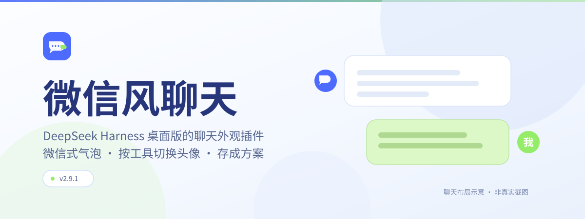

<p align="center">
  
</p>

<h1 align="center">微信风聊天</h1>

<p align="center">
为 <strong>DeepSeek Harness（DSH）桌面版</strong>添上微信式气泡、个性头像与昼夜皮肤。<br>
让助手在使用不同工具时换上对应头像，也让每个智能体拥有自己的一套聊天外观。
</p>

用户消息在右，助手消息在左。Markdown、代码高亮、流式输出、复制、重试和工具折叠卡片都保留 DSH 原生交互。

<p align="center">
  <strong>当前版本 2.9.3</strong> ·
  <a href="#安装">安装</a> ·
  <a href="#快速上手">快速上手</a> ·
  <a href="#头像方案">头像方案</a> ·
  <a href="#重要边界">重要边界</a> ·
  <a href="#文档">文档</a>
</p>

## 亮点

| 能力 | 说明 |
|---|---|
| **微信式布局** | 左右气泡搭配自定义头像，头像支持方形、圆角和正圆，也能保留 GIF 动画。 |
| **按工具换头像** | 搜索/浏览、读文件、写文件、命令/测试四类分别配图，也能为具体工具单独设置头像。 |
| **发言头像固定** | 每段助手发言输出完成后单独保留头像；同一轮后续切换工具，也不会改掉前面那句话的头像。刷新后仍保留。 |
| **自定义气泡外观** | 保留七种内置样式，也能导入自己或 AI 制作的设计；支持配色、花边、角花、人物挂件和深浅主题。 |
| **头像方案** | 把整套设置存成具名方案，再绑定到 DSH **智能体预设**；单个会话可临时选用其它方案，支持导入/导出。 |
| **先预览，再保存** | 头像大小、圆角、背景、描边及气泡颜色、圆角、宽度可先预览，满意后点「保存外观」。 |

## 自定义气泡外观

打开 **聊天外观 → 自定义气泡外观**，选择内置样式，或点击 **「导入设计」** 加入自己的气泡。

1. 点击 **「下载 AI 制作说明」**，把说明交给 AI，再描述你想要的风格。
2. 让 AI 交付一个 `.json` 设计文件；也可以从 **「下载示例」** 开始自己修改。
3. 点击 **「导入设计」**，选中文件。校验通过后立即应用，并保存到当前头像方案。

**直接下载：** [AI 制作说明](docs/AI气泡制作说明.md) · [可导入示例：月光信笺](docs/examples/moonlight.bubble.json) · [JSON Schema](docs/bubble-design.schema.json)

每份头像方案保存一个自定义设计；想保留多套设计，先复制头像方案，再分别导入。可以用「导出设计」单独分享，也会随整套头像方案一起导出。切换到内置样式不会删除已导入设计。

设计文件自带素材，不需要外链；支持 SVG 源码、PNG/WebP/JPEG 的 base64 数据。格式上限为 **512 KiB**，文件内不包含聊天文字。短句气泡按内容收紧，人物挂件贴住底角，在框外预留间距。

七种内置样式仍可直接使用：

| 样式 | 风格 |
|---|---|
| **素笺** | 简洁基础气泡，可自定义配色、圆角与毛玻璃效果。 |
| **猫猫信笺** | 奶油色小猫化作气泡，文字落在猫咪肚子里。 |
| **莉栀小笺** | 白龙、翅膀与银白裙边，精致柔和。 |
| **田园来信** | 雏菊、格纹与布艺，像一封田园来信。 |
| **鱼鱼·潮汐来信** | 海浪、珍珠与裙边，带着海洋气息。 |
| **猫耳鱼鱼** | 猫耳、星光与蓝白蝴蝶结，更添俏皮。 |
| **澄蓝水波** | 澄蓝气泡搭配顶部高光、层叠水波与白字。 |

后六种内置样式及导入设计为完整皮肤，配色与轮廓由设计控制，暂时停用自定义气泡色、气泡圆角和毛玻璃；头像与气泡最大宽度仍可调整。
切回「素笺」会恢复你保存的自定义设置。

另有可选的**鲸鱼海浪开关**：在「聊天外观 → 界面美化（全局）」开启，为 DSH 标准开关换上鲸鱼与海浪装饰。它独立保存，不属于头像方案。

## 安装

1. 从仓库的 **Code → Download ZIP** 下载并解压，或使用 Git 克隆本项目。
2. 在 DSH 里用插件管理工具把**含 `package.json` 的这一层目录**作为 bundle 安装。操作名称示意如下（这是 DSH 的工具操作，不是 PowerShell / 系统终端命令）：

   ```
   plugin_manager install_bundle <本目录的绝对路径>
   ```

3. 安装后刷新页面即可生效。

本项目**无需构建**，修改源码后同样通过刷新页面生效。

## 快速上手

打开方式：**设置 → 插件 → 「微信风聊天」→ 配置面板**。设置页分四个页签：**头像 / 聊天外观 / 工具规则 / 头像方案**，
顶部「正在编辑」显示当前在改哪一份方案（默认方案就是旧版的全局设置）。

1. **配头像**：点头像预览图或「上传」选图，在裁剪窗中拖动、缩放，再点「应用裁剪」。也可填图片 URL；GIF 默认保留动画。
2. **挑样式、调外观**：选择喜欢的内置皮肤，或在「自定义气泡外观」导入设计，再调整头像大小、圆角、背景、描边和气泡设置。「预览大小」可以打开样例弹窗，用当前头像对照效果。
3. **保存调整**：头像大小、圆角、背景、描边，以及气泡颜色、圆角、宽度都**先预览**。满意后点 **「保存外观」** 应用到聊天；点 **「取消调整」** 放弃草稿。
4. **设置角色头像（可选）**：点击聊天输入框旁的「角色头像」，上传角色图片，选择「开启 / 关闭 / 自动」。模式切换从当前未结束轮（空闲时从下一轮）生效；自动模式需要助手正文中的约定标记。
5. **选用方案（可选）**：点击输入框旁的「头像方案」，给本会话临时选一个。点「跟随预设」取消临时选择；选「默认方案」则明确使用默认方案。

> **保存小提示**：松手、关闭选色器、导出或切换方案都不会替你保存外观草稿。设计导入、主题、皮肤、毛玻璃等操作，以及头像上传、工具规则和角色模式，仍按各自操作独立保存，无需再点「保存外观」。

卸载：在插件管理器里禁用或移除本 bundle，插件会清理自己注入的界面样式与组件。

## 头像方案

- **先建立绑定，再跟随预设**：在「头像方案」页签中，把方案绑定到 DSH 智能体预设。使用该预设的会话就会采用对应方案；预设改名后，绑定仍按 ID 生效。
- **生效顺序：本会话临时选择 > 本会话实际预设的绑定 > 默认方案。**
- **默认方案**就是旧版的全局配置，**既没有临时选择、预设也没绑定的会话都跟随它**，老用户不需要做任何事。
- **「跟随预设」≠「选默认方案」**：前者是取消覆盖，后者是一条明确的覆盖。
- 一个方案 = 一整套外观（用户/助手/角色/工具头像 + 大小、圆角、背景、描边 + 气泡、主题、合并头像、时间戳）。**改一个方案会影响所有使用它的会话与预设**，想互不影响就分开用不同方案。
- 支持创建、复制、改名、删除、导入、导出。导出包含方案名与配置（包括已保存的头像数据或图片 URL），**不含**预设绑定、会话绑定、聊天记录、每轮头像历史或角色模式历史；导入一律作为新方案加入，重名自动加序号。
- 删除正在被使用的方案时，界面会说明「N 个会话的临时选择、M 个预设的绑定被清理」，它们按优先级回落。
- 插件**不写 DSH**：只读预设的 ID 与名称用来做绑定，不切换会话实际使用的智能体，也不改预设、模型或提示词。
- **角色模式不属于方案**：「自动 / 开启 / 关闭」由各会话按轮次单独记录。

## 头像规则

- 优先级：**精确工具名规则 > 工具类型 > 默认头像**，留空表示没配。四类为搜索/浏览、读文件、写文件、命令/测试。
- 每轮独立结算：按工具调用的**开始顺序**取本轮最后一个匹配头像；下一轮没有匹配就回落默认头像，不继承上一轮。启用且配置了角色头像时，工具运行期间临时显示工具头像，结束后回到角色头像。
- 角色头像可以用「手动开启/关闭」，也可以让助手在正文里写约定标记自动切换。插件**只换头像**，不会因为你说了「你是猫娘了」之类的自然语言就自己换，也不会改角色设定或提示词。

## 重要边界

- **只改外观**：不替换消息渲染器；读取宿主会话快照中的工具信息与助手正文里的约定标记，不根据自然语言猜角色，不修改角色设定或提示词。
- **数据在本地**：配置存在浏览器 `localStorage`，每轮头像历史存在插件自己的 IndexedDB。它们是**当前来源 / 当前浏览器**的数据，**不是账号级同步，也不会跨设备同步**。
- **图片使用方式**：本地选图由插件在浏览器内处理，没有后端上传接口；使用远程图片 URL 时，浏览器会向该地址请求图片。同一 URL 指向的图片若发生变化，历史头像也会跟着变。
- **时间戳是本地近似渲染时间**，不是服务器给出的消息时间。
- **历史保留的是头像身份**：图片、字母与决定头像的规则按轮次保留，大小、圆角和气泡等外观仍跟随当前已保存设置。功能启用前已经丢失的旧图片无法恢复。
- **本地保存也可能失败**：外观保存失败，或头像历史数据库不可用、配额不足时，会有提示；当前窗口仍能显示的内容，刷新或重开后可能丢失。
- **兼容范围**：2.9.3 已针对本机 DSH **0.2.1-rc.3**（build `be72761ee1a6736ebcdf4f3739363b083ae53c98`）完成隔离浏览器验证，包含该版本原生聊天组件与节点存储。未操作真实会话；后续宿主升级仍需检查 DOM 和接口变化。

## 文档

- [AI 气泡制作说明](docs/AI气泡制作说明.md) —— 直接交给 AI 的格式规范、素材规则与完整示例。
- [气泡 JSON Schema](docs/bubble-design.schema.json) —— 字段与数值范围校验；SVG 和图片内容仍由插件验证。

- [使用说明](docs/使用说明.md) —— 每个按钮干什么、标记怎么写、出错怎么排查、数据与隐私。
- [配置字段](docs/配置字段.md) —— 所有配置项的默认值、类型、取值范围，以及存储键结构。
- [代码导读](docs/代码导读.md) —— 代码怎么被加载、模块划分、头像决策与数据流、扩展时改哪里。

<details>
<summary><strong>仓库结构</strong></summary>

```
dsh-wx-chat/
├─ package.json          bundle 清单：dsh.bundle.patch + dsh.client + 分发文件列表
├─ cordis.patch.yml      把插件行插入宿主插件名单（安装/卸载 bundler 读它）
├─ index.js              Host 半边入口（纯展示插件，空实现）
├─ client.js             全部功能：样式注入、头像引擎、配置面板、弹窗、会话内组件
├─ assets/               矢量花边与装饰、角色插画、猫猫皮肤（运行时离线内嵌）
├─ icon.svg              插件图标
├─ locale/               插件管理器里显示的名称与描述（中/英）
├─ README.md             本文件
└─ docs/
   ├─ AI气泡制作说明.md    可直接交给 AI 的气泡规范
   ├─ bubble-design.schema.json  机器可读的字段规范
   ├─ examples/          可直接导入的设计示例
   ├─ images/            本页头图等文档素材
   ├─ 使用说明.md         面向使用者
   ├─ 配置字段.md         面向维护者
   └─ 代码导读.md         面向解包与二次开发
```

</details>

<details>
<summary><strong>近期更新</strong></summary>

- **2.9.3** 每段助手发言定稿后单独固定头像，后续工具与角色切换不再重画前文；按消息身份持久化，刷新/折叠重挂保持一致，原有头像历史自动保留。
- **2.9.2** 降低长会话开销：普通流式正文复用头像索引，头像仅监听所属会话；时间戳按消息事件更新，取消每 30 秒全页扫描；皮肤图片样式按需加载，保留现有外观与保存方式。
- **2.9.1** 适配 DSH 0.2.1-rc.3：聊天行和流式光标改用语义属性定位，修复气泡/头像失效；保持折叠消息隐藏。人物挂件向头像侧靠近最多 10px，并保留至少 8px 间隙。
- **2.9.0** 自定义气泡设计导入/导出，内置 AI 制作说明与示例；设计随头像方案保存，支持独立昼夜配色和分层素材。短句去掉由头像尺寸带来的固定最小高度，挂件贴住底角，保持原比例并避开文字、头像与下一条消息。
- **2.8.6** 头像圆角 100% 明确按普通圆弧画成正圆，不再受全局圆润方形（corner-shape）样式影响；聊天、设置缩略图、外观预览与放大层保持一致，0% 与中间档位沿用原有映射。
- **2.8.5** 外观改为显式保存：颜色、头像大小/圆角/背景/描边、气泡圆角与宽度只在设置与弹窗里实时预览，点「保存外观」才应用并写盘，「取消调整」丢弃草稿；连续调节不再整块重渲染配置面板，也不会刷新聊天气泡。
- **2.8.3** 新增「澄蓝水波」并重做完整皮肤：独立 SVG 花边按固定尺寸连续铺排、角色保持原比例、昼夜各自配色，预览卡统一 76×40 CSSpx。
- **2.6** 全局鲸鱼海浪开关（覆盖宿主标准开关，保留点击/键盘/禁用与无障碍语义，独立保存）。
- **2.4.0** 每轮头像历史（IndexedDB，跨轮共用同一份图片）、行内代码可读性修复。
- **2.3.0** 头像方案及智能体预设绑定、会话临时覆盖、方案导入与导出。

更早的细节与技术说明见 [代码导读](docs/代码导读.md) 与 git 历史。

</details>

<details>
<summary><strong>开发与验证</strong></summary>

- **没有构建步骤**：`package.json` 里没有 `scripts`，改完源码让 DSH 重载插件 / 刷新页面即可。
- **仓库不含测试夹具**：历史测试脚本属于开发者本地环境，不在分发包内。要回归功能，请在 DSH 里重载插件后手动核对头像切换、裁剪弹窗、GIF 保留动画、角色模式边界，以及卸载后界面恢复原生。
- **本次核对版本**：DSH 0.2.1-rc.3，build `be72761ee1a6736ebcdf4f3739363b083ae53c98`。75 项功能回归、79 项性能/行为检查及 47 项分段头像检查通过，覆盖真实聊天组件、工具头像、多会话隔离、历史头像、流式光标、折叠隐藏、自定义气泡导入及桌面/窄屏布局；不等同于真实会话端到端验证。
- **升级宿主后仍需检查**：聊天行使用 `data-chat-flow-kind`、轮次使用 `data-chat-turn`；流式光标使用 `data-streaming`，不再绑定旧构建的完整 hash 类名。内层气泡和 Markdown 仍依赖局部结构与类名片段，检查方法见 [代码导读](docs/代码导读.md)。

</details>

## 第三方与致谢

- 内置的 DeepSeek 鲸鱼 logo path 来自 `@deepseek-ai/dsh-client-ui-primitives` 的 `FISH_LOGO_PATH`，已作为常量内嵌在 `client.js` 中（属必须保持完整的常量，请勿手改或重新格式化）。
